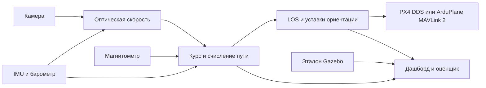

# Визуально-магнитная навигация планера без GPS

Актуальная приемка 12 ноября: **90 с GUIDED, flight=true, accuracy=true**.
Основной тракт: прямые FLU IMU/барометр → ROS 2, камера и магнитометр →
визуальная навигация; управление ArduPlane 4.6.3 — MAVLink.
RMSE Vx/Vy 0,113/0,132 м/с, высоты 0,0075 м; ATTITUDE roll/pitch
0,58°/1,09°. Устранена внутренняя очередь UART SITL; возраст MAVLink IMU
и давления max 12 мс. [Полный отчет и ограничения](docs/ACCEPTANCE_2026-11-12.md),
[машиночитаемая приемка](docs/results/acceptance_20261112.json).
Чистый MAVLink-сенсорный режим остается экспериментальным по точности.


Стенд ROS 2 Jazzy и Gazebo Harmonic для навигации по надирной камере,
магнитометру, IMU и барометру. Навигация строится в локальных координатах ENU.
Контур управления использует только оценку по датчикам; истина Gazebo доступна
только оценщику и дашборду.

Основной запуск использует ArduPlane 4.6.3 и glider_visual в Gazebo Harmonic.
Штатное армирование и управляемое планирование в GUIDED подтверждены в SITL.
Точность навигации и удержания маршрута пока не прошла приемку.
PX4 сохранен как отдельный контур совместимости.



## Модель

Мировая система ENU: X восток, Y север, Z вверх. Корпус FLU: x вперед,
y влево, z вверх. Оптическая система: x вправо по изображению, y вниз,
z вдоль оси. Матрица камера → корпус: R_BC = [[0,-1,0],[-1,0,0],[0,0,-1]].
Она ортогональна и имеет det +1.

Нормализованный луч q = K⁻¹[u,v,1]ᵀ. Для горизонтальной камеры и плоской
земли Vx = h Δv/(fy Δt), Vy = h Δu/(fx Δt). Общая модель использует
индивидуальную глубину Z_i = h/(n_C·q_i). Из измеренного потока вычитается
вращательная компонента B_i ω_C. Поступательная скорость оценивается
SVD с весами Хьюбера; треки проходят cornerSubPix, LK вперед–назад и RANSAC.
Гироскоп интегрируется по интервалу кадров при полном покрытии буфера.
Смещение центра камеры компенсируется через ω_B × r_BC.

Магнитное измерение нивелируется: m_L = Ry(θ) Rx(φ) m_B.
Курс ψ = wrap(π/2 − D − atan2(m_Ly,m_Lx)); D положительно к востоку.
Вектор скорости поворачивается в ENU через Rz(ψ) Ry(θ) Rx(φ).
XY интегрируются трапециями, масштаб задается барометрической высотой
над известной плоскостью. Нет источника абсолютной поправки XY:
систематические ошибки скорости и курса накапливаются.

Для участка A→B поперечная ошибка e⊥ — нормированное векторное произведение
(B−A) × (P−A), положительное слева. χd = wrap(χpath − atan2(e⊥, L)).
Ускорение 2V² sin(χd−χ)/L ограничивается по максимальному крену;
φd = −atan2(a⊥, g). χ — направление движения, ψ — направление носа.
Преобразование ориентации в автопилот: R_NED,FRD = T R_ENU,FLU S,
где T меняет местами E/N и инвертирует Z, S=diag(1,−1,−1).

## Сборка и запуск

Требуются Ubuntu 24.04, ROS 2 Jazzy, ros_gz_bridge, Gazebo Harmonic
и dev-пакеты gz-sim8, gz-sensors8, gz-plugin2, OpenCV, ROSIDL.
Python: pymavlink, scipy, rclpy; для окна python_qt_binding. В WSL
используется профиль FastDDS с UDP loopback и небольшими фрагментами.

Из корня проекта:

```bash
bash src/glider_visual_nav/tools/build_arduplane.sh
source /opt/ros/jazzy/setup.bash
source build_visual_nav/ardupilot_deps/python/bin/activate
colcon --log-base log_visual_nav build --base-paths "$PWD/src/glider_visual_nav" \
  --build-base build_visual_nav --install-base install_visual_nav \
  --cmake-args -DBUILD_PX4_INTERFACE=OFF
source install_visual_nav/setup.bash
colcon --log-base log_visual_nav test --base-paths "$PWD/src/glider_visual_nav" \
  --build-base build_visual_nav --install-base install_visual_nav
colcon test-result --test-result-base build_visual_nav/glider_visual_nav/test_results
```

Для существующего PX4-стенда требуется его SITL и px4_msgs; оставить
BUILD_PX4_INTERFACE=ON и использовать demo.sh px4 start.
Самостоятельная сборка ArduPlane не требует сборки PX4.

```bash
# Терминал 1: ArduPlane + Gazebo + ROS; Ctrl+C останавливает этот запуск.
bash src/glider_visual_nav/tools/demo.sh ardupilot run
# Терминал 2: окно оценки, терминал 3: GUI Gazebo.
bash src/glider_visual_nav/tools/demo.sh ardupilot dashboard
bash src/glider_visual_nav/tools/demo.sh ardupilot gui
```

В мире ArduPlane камера стартует на 145 м над плоскостью. Подробнее о тарировке, фазе IMU и текущем результате: [отчет 5 ноября](docs/ARDUPLANE_2026-11-05.md), [итог проверки](docs/results/arduplane_guided_2026-11-05.json).

Команда ardupilot fly один раз освобождает испытательное крепление и задает
начальные 16 м/с. Это воздушный старт, не алгоритм взлета.
Мост по умолчанию наблюдает и не армирует самолет. Команды ориентации
разрешаются явным ARDUPLANE_ENABLE_CONTROL=true и только при свежих
данных, подтвержденных GUIDED и armed. Файл arduplane_glider.parm отключает
GPS через GPS1_TYPE/GPS2_TYPE (в 4.6 это актуальные имена), включает EKF3
и ExternalNav. Запись параметров не доказывает прием EKF или летную годность.

UDP: endpoint udpin:127.0.0.1:14550; UART: тот же узел с endpoint
/dev/serial/by-id/… и baud=921600. OPTICAL_FLOW_RAD отправляется из отдельного
интегрального ROS-сообщения и не подменяется метрической скоростью.
Backend 4.6.3 AP_OpticalFlow_MAV ожидает OPTICAL_FLOW, поэтому основная
ветвь здесь — ExternalNav. Телеметрия моста пока отмечается временем
приема в ROS; для аппаратного полета нужна проверенная синхронизация часов.

## Маршрут и проверка

Менять пары координат в flight.yaml (PX4) или arduplane_navigation.yaml
(ArduPlane), блок los_controller_node. Параметры читаются при запуске.
Например: waypoints: [0.0,0.0,160.0,0.0,160.0,100.0,0.0,100.0].
При loop_waypoints=true не повторять первую точку. Перезапустить стенд;
для PX4 обновить установленную копию конфигурации через colcon build.

В окне: маршрут, камера, навигационная траектория и независимый эталон.
Графики отвечают на три разных вопроса: точность навигации (оценка − эталон),
качество следования маршруту (эталон − линия) и исполнение команд
(заданный − фактический крен/высота). Экспорт JSON, CSV и PNG.
Повороты ограничены радиусом; высокая ошибка на смене участка может быть
следствием геометрии и не доказывает потерю курса.

| Испытание | Результат |
|---|---|
| Контрольный PX4, 45 с, ранее сохраненный | RMSE Vx/Vy 0,071 / 0,121 м/с; курс 1,07°; дрейф 6,50 м (1,23%) |
| Пассивный glider_visual, 75 с симуляции | 19,71 с в воздухе по критерию стенда; 1997 кадров; около 309 м до остановки; без GUIDED |
| Длительный PX4 с новой математикой | 1200 с, 14,288 км; дрейф 121,89 м (0,853%); RMSE Vx/Vy 0,179 / 0,106 м/с; курс 1,642° |

[Оптический поток и бюджет Raspberry Pi](docs/OPTICAL_FLOW_AND_OPENFLOW_STUDY.md) ·
[Аппаратура и соединения](docs/HARDWARE_BOM_AND_ARCHITECTURE.md) ·
[Дашборд](src/glider_visual_nav/DASHBOARD_RU.md)

Дрейф не улучшился относительно приблизительного ориентира 100 м.
Это не сравнение двух одинаковых испытаний. [Исходные агрегаты](docs/results/night_stage1_1200s.json).

Метрики симуляции не являются допуском к реальному полету.

### Текущая диагностика IMU

Поток IMU и одометрия на креплении восстановлены: 2833 и 2625 сообщений
соответственно. Найдена и исправлена установка IMU в FLU вместо FRD
для ArduPilotPlugin. Отправка OPTICAL_FLOW подключена к производному потоку
из узла камеры. Это исторический результат до исправления bootstrap EKF3.
Последующее штатное армирование и полет подтверждены ниже; уменьшение
дрейфа и приемлемая точность ArduPlane не подтверждены.
[Разбор](docs/IMU_CHAIN_DIAGNOSIS_2026-11-05.md).

### Последний полет: 5 ноября

GUIDED и штатное армирование подтверждены. 90 с после освобождения,
около 87,9 с непрерывного полета; финальная высота корпуса 12,9 м.
Это Plane 4.6.3 с двумя воспроизводимыми патчами SITL: фиксированное
магнитное поле мира и bootstrap EKF3 при выбранном ExternalNav без GPS.
ARMING_CHECK не отключен. Проверка точности маршрута не пройдена:
на окне наблюдения RMSE курса 15,5°, RMSE e⊥ 53,6 м.
[Метрики](docs/results/arduplane_guided_2026-11-05.json).

### Основной запуск теперь ArduPilot

demo.sh start запускает ArduPlane в режиме наблюдения, gui открывает Gazebo,
dashboard — окно ROS 2. Автоматический тест с нормальным армированием:
bash src/glider_visual_nav/tools/demo.sh flight 60
Не запускать его одновременно с start. По окончании теста его процессы
останавливаются, а открытые графики могут показывать устаревшие данные.
PX4 сохранен через demo.sh px4 start. Для новой сборки адаптер PX4 выключен
по умолчанию; для старого стенда явно включить BUILD_PX4_INTERFACE=ON.

[Карта требований и выбор компонентов](docs/PROJECT_REQUIREMENTS_RU.md).
[Разложение ошибок на крен и скорость](docs/results/navigation_error_decomposition.json).
Очередь кадров теперь ожидает покрытие интервала IMU; ее тесты проходят,
но улучшение скорости на виражах не подтверждено: ошибка оценки крена
в записанном окне около 13°. Требуется устранить ошибку ориентации,
а не подгонять курс по эталону Gazebo.

Последняя диагностика 12 ноября: [разбор согласования сенсоров](docs/ALIGNMENT_DIAGNOSIS_2026-11-12.md).
Это историческое состояние до исправления UART и прямого сенсорного тракта; актуальная приемка приведена в начале README.
